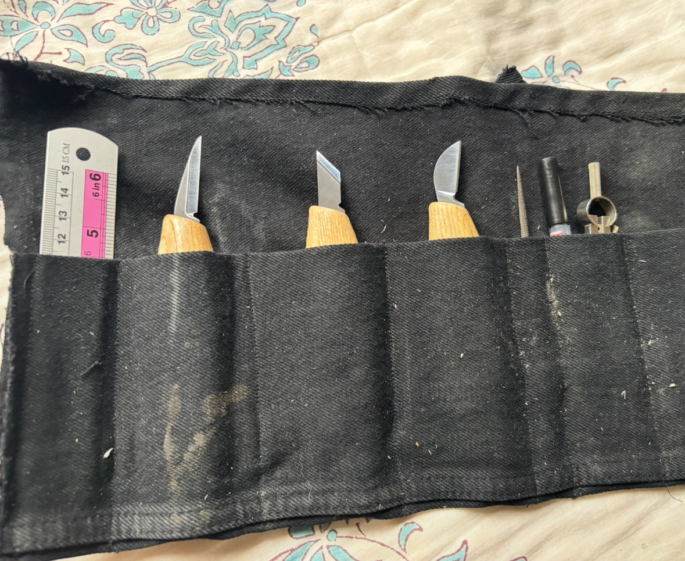
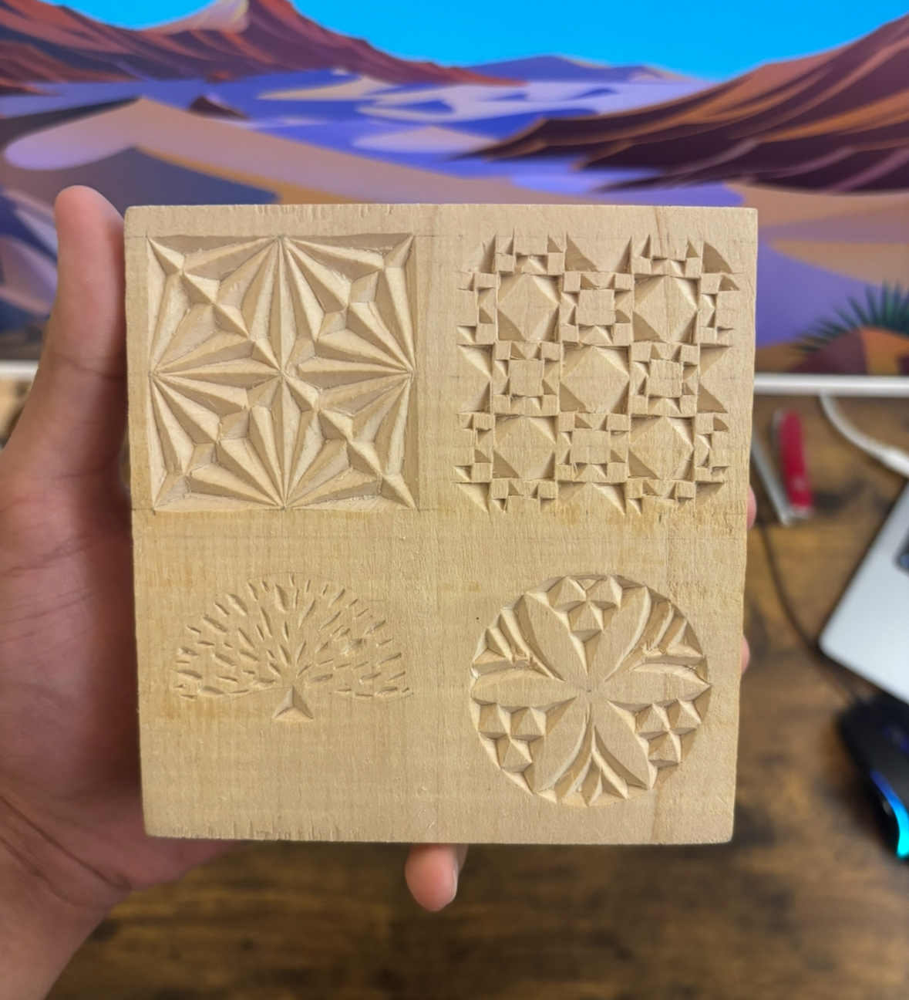
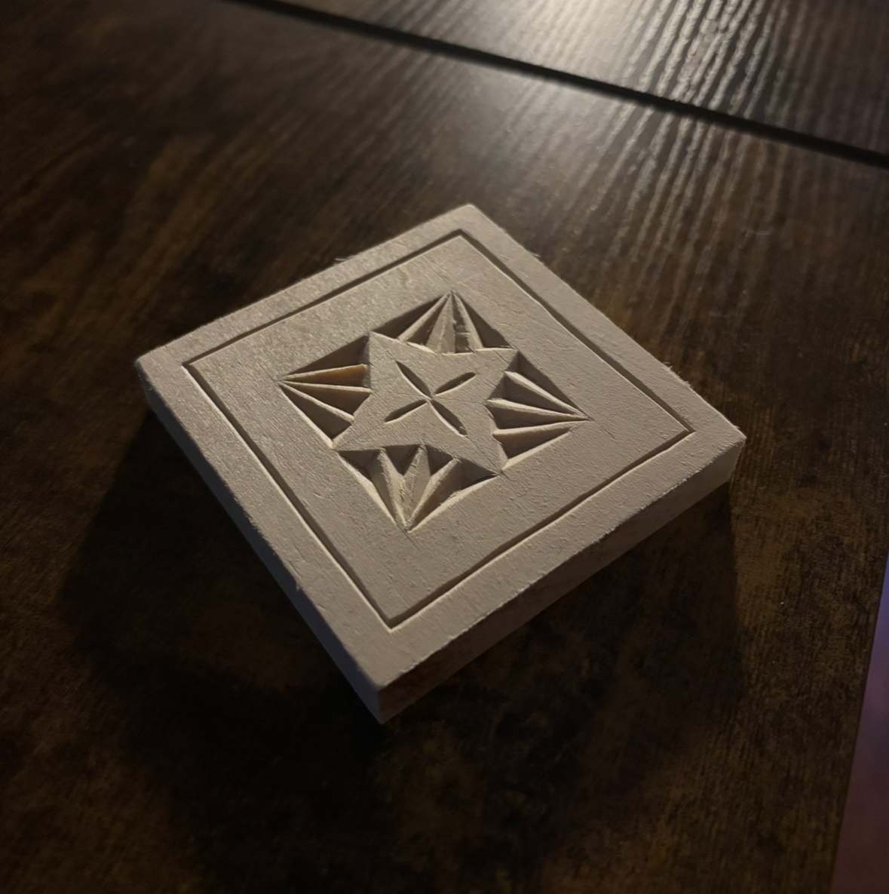
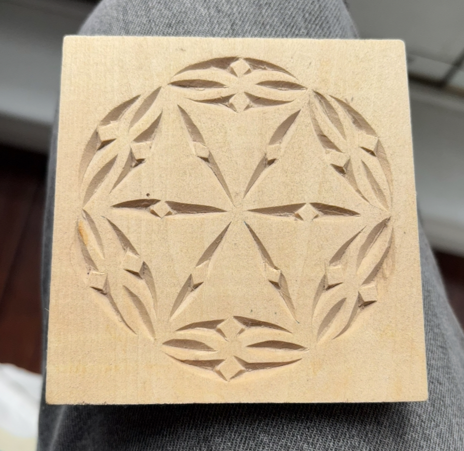
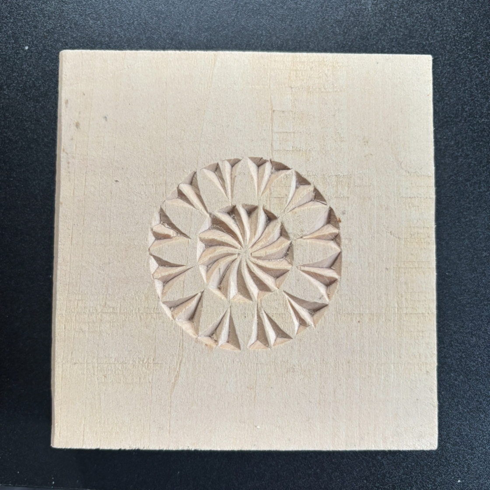
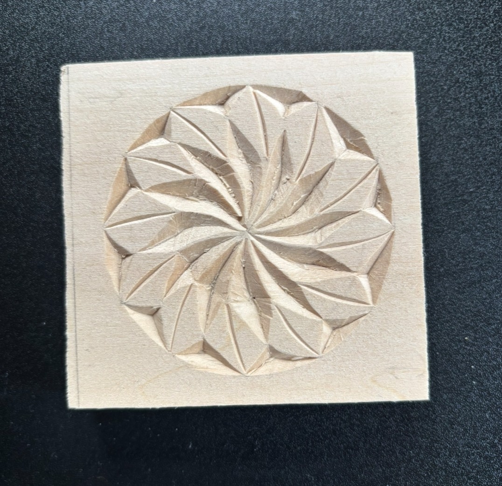
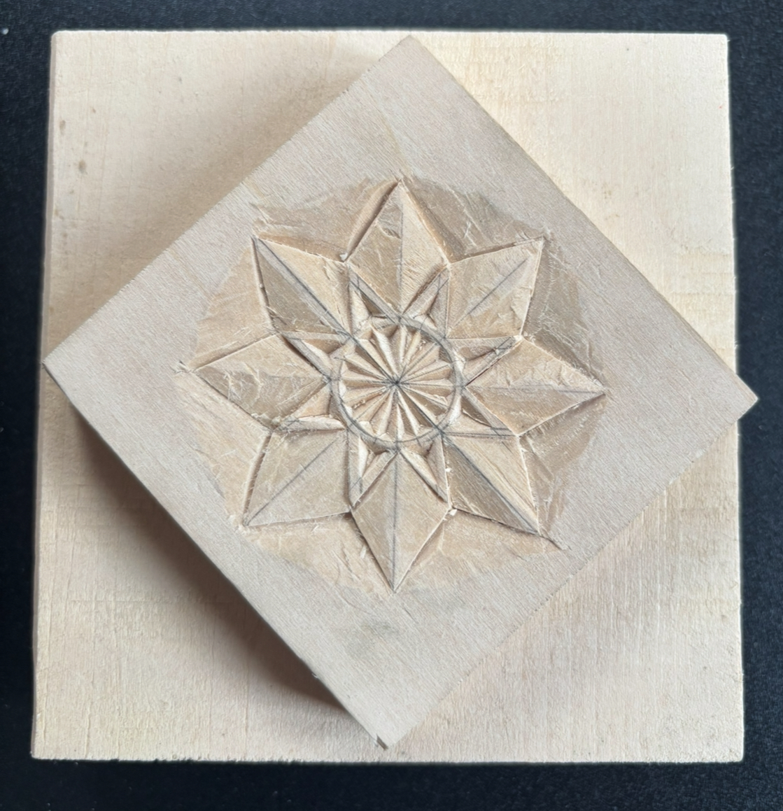

# Wood carving
This is the hobby that I've spent the longest time on. I started with whittling, which made me realize that I **ADORE** taking something and uncovering something that was always _inside_ it.

I love how relaxing it is, how few tools you need to get started, and how much you can progress with just deliberate effort. There aren't many secrets with it, and there is next to nothing that you can pay your way out of. 

## My tool kit

This is my tool kit; yes, it rolls up and I stitched it myself.

I've got:
1. a ruler
2. 3 knives (detail, skew, chip)
3. a small file
4. a compass and some replacement leads.

It ain't much, but it works. I might add a hatchet knife to my collection because I find that my skew knife can't cut some shapes that I want to remove.

## What I make
Like I said before, I started by whittling with my detail knife. Despite how accident prone I was and how sketchy my initial cuts were, it was still quite satisfying. 

My first ever carving was a [squirrel](/hobby/wood-carving/pieces/squirrel.jpg). It's somehow not the worst thing I've ever carved, but that's a title that a few things are competing for. The very next thing I attempted to carve was [bear](/hobby/wood-carving/pieces/bear.jpg). If you know me well, you know why this might have been important to me at the time. I got really into tring to carve out the features. I never did fully get the hang of it.

I've whittled a few other things over the years, but I've given them all away. Examples include a couple of gnomes, and a generic buff dude that I left on top of the power rack at my old gym (I didn't see him the next time I went, so hopefully Arnold's new owner treat's him well).

The other style that I got much more into is chip carving. I was introduced to it by some old videos by a man named Daniel Clay on youtube. I believe he attempted to popularize it in the west many decades ago, based on the Swiss version, Kerbschnitzen. I have since found a few other authors on the topic from all over the world, like Tatiana Baldina, a Russian carver (I just checked out a book from the library by her :).

I find myself drawn to geometric patterns more than anything else, although I have experimented.

This was my first practice board. I tried a bunch of different cutting techniques, and even (re)invented some!

Here are a couple more simple designs I have laying around my place. Yes, they make great coasters!

Of course not all pieces look remotely decent. For example, the one below was a piece where I attempted layering cuts into each other in a certain way, only to discover a bunch of ways not to do it. Unfortunately the pieve couldn't be salvaged, even by removing the layers.

I'll figure it out someday though, and when I do, I'm going to turn it into a piece of wall art.

*First posted 2026-11-14*